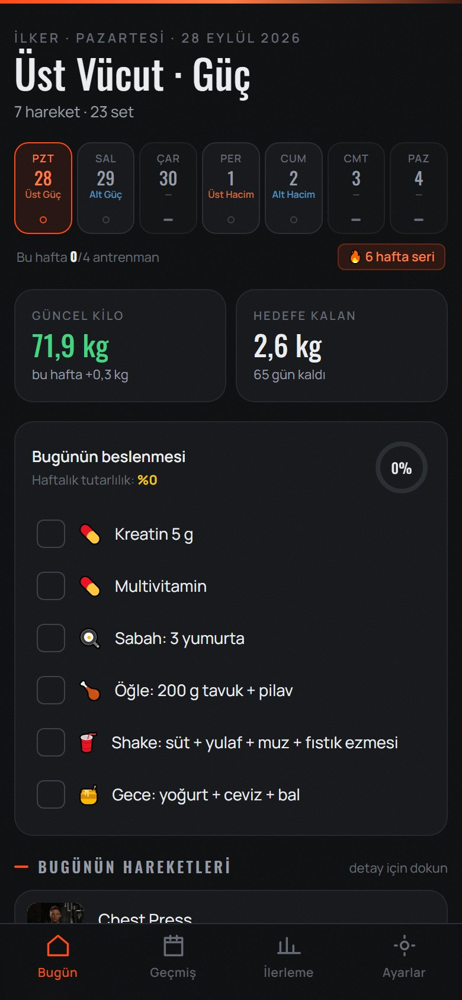
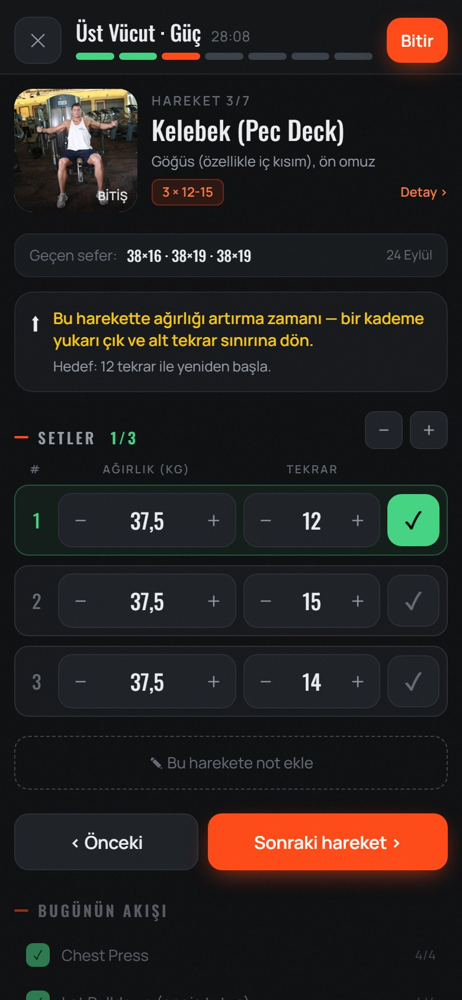
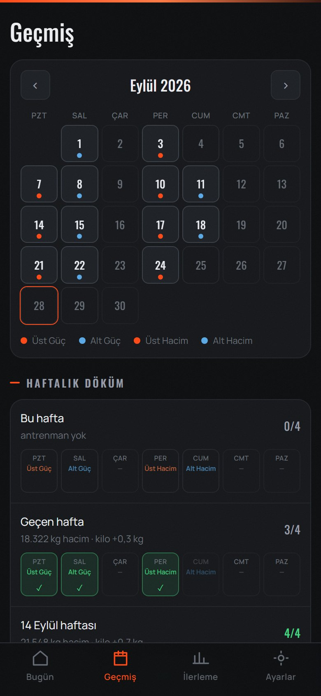
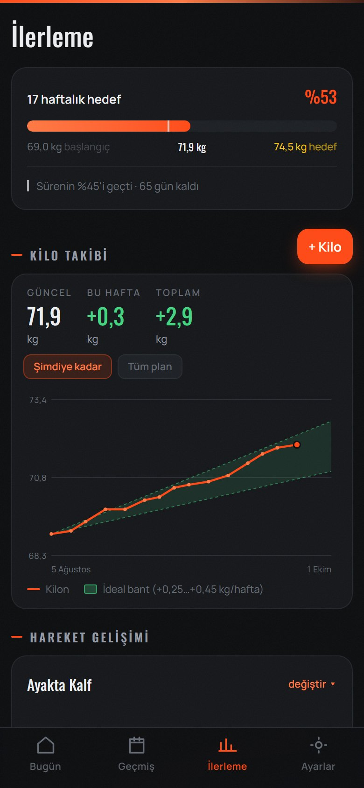

# Demir — Antrenman ve Kilo Takip Uygulaması

    

**Kişiye göre kurulan, tamamen çevrimdışı çalışan bir antrenman defteri.** Hesap yok, sunucu yok, reklam yok; tüm veriler cihazda kalır. Tarayıcıda PWA olarak ya da Android'de APK olarak çalışır.

> *English summary below.*

<p align="center">
  
  
  
  
</p>

## Özellikler

- 🧭 **Kurulum sihirbazı:** Hedef (kilo alma / verme / koruma), antrenman programı, haftalık plan ve ekipman seçilir; uyarılar, öneriler ve grafikteki ideal bant buna göre şekillenir
- 🏋️ **Antrenman ekranı:** Her hareket geçen seferki ağırlık ve tekrarlarla dolu gelir; set onayı, dinlenme sayacı (titreşimli), hareket görseli ve açıklaması
- 📈 **Ağırlık artırma önerisi:** Hedef tekrar aralığının üst sınırına ulaşınca bir kademe artırma zamanı geldiğini söyler (progressive overload)
- ⚖️ **Kilo takibi:** Haftalık değişim, hedefe kalan süre, ideal ilerleme bandıyla grafik
- 📅 **Geçmiş:** Takvim, haftalık döküm, toplam hacim, rekorlar
- 🥗 **Günlük beslenme listesi** ve haftalık tutarlılık yüzdesi
- 🔄 **Hareket değiştirme:** Ekipman yoksa (ör. barfiks barı) hareket otomatik olarak alternatifiyle değişir
- 💾 **Yedekle / geri yükle:** JSON dosyasıyla; Android sürümü yedeği İndirilenler klasörüne yazar
- 📴 **Çevrimdışı:** Service worker ile bir kez açtıktan sonra internetsiz çalışır

## Teknik notlar

- **Tek durum ağacı + `localStorage`:** Tüm uygulama durumu tek bir store hook'unda; her değişiklik kalıcı hale getirilir. Dışarıdan gelen veri (eski sürüm yedeği, elle düzenlenmiş dosya) bir normalizasyon katmanından geçirilerek eksik alanlar varsayılanlarla tamamlanır ve bozuk program onarılır.
- **Android paketi Gradle'sız:** `android/derle.ps1`, `dist/` çıktısını tek dosyalık bir Java `MainActivity` içine gömer; dosyalar `WebViewAssetLoader` ile `https://appassets.androidplatform.net` kökünden sunulur (localStorage'ın güvenilir çalışması için). Uygulama yalnızca `VIBRATE` izni ister; antrenman sırasında ekranı açık tutar ve geri tuşunu yönetir.
- **Mobil öncelikli arayüz:** Tailwind 4, Oswald + Manrope değişken yazı tipleri, başparmakla kullanılacak büyük dokunma alanları.

## Çalıştırma

```bash
npm install
npm run dev           # tarayıcıda geliştirme
npm run build         # dist/ — PWA olarak yayınlanabilir
powershell -File android/derle.ps1   # imzalı Android APK (JDK 17 + Android SDK build-tools gerekir)
```

---

## English

**Demir** ("iron") is an offline-first workout and body-weight tracker built with React 19, Vite and Tailwind CSS. A setup wizard builds the plan around the user's goal, programme and available equipment; during a session it pre-fills last time's weights and reps, runs a rest timer and suggests when to increase the load. All data stays on the device (`localStorage`), it works offline as a PWA, and it ships as an Android APK through a minimal, Gradle-free WebView wrapper.

## Lisans

Kod: MIT © 2026 İlker Tokat · Hareket görselleri: [free-exercise-db](https://github.com/yuhonas/free-exercise-db) (Unlicense, kamu malı)
